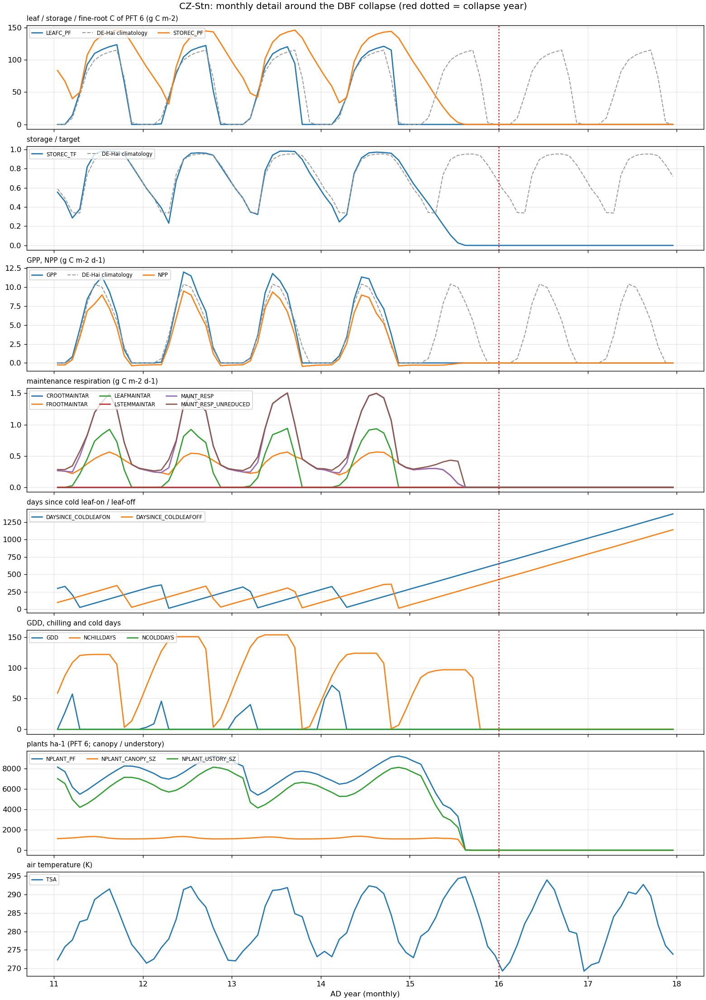
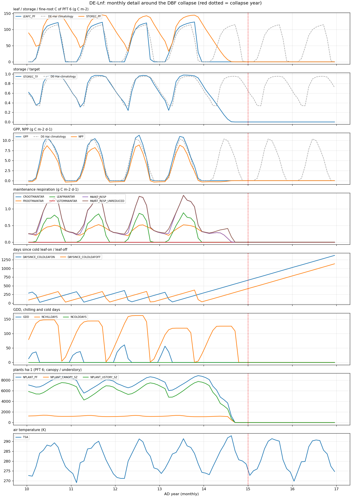

# DBF collapse at CZ-Stn / DE-Lnf: monthly detail vs DE-Hai

```
REFERENCE (living DBF, per-year medians): leafC_DecFeb_frac_of_max 0.00, leaf_flushes 0.00, leaf_months 7.00, cold_leafon_events 2.00, cold_leafoff_events 2.00, storage_TF_min 0.29

CZ-Stn: collapse year 16
  year  11: GPP 4.41, leaf months 7, flushes 0, leaf-on/off events 2/2, Dec-Feb leaf C 0.00 of max, storage/target min 0.29 (month 3), plants 7213, canopy/understory 1193/6010, cohorts 295.4  <-- EXTRA LEAF FLUSH
            winter (Nov-Mar) maintenance respiration: FATES_CROOTMAINTAR 0.000; FATES_FROOTMAINTAR 0.281; FATES_LEAFMAINTAR 0.005; FATES_LSTEMMAINTAR 0.000; FATES_MAINT_RESP 0.286; FATES_MAINT_RESP_UNREDUCED 0.316
  year  12: GPP 4.31, leaf months 7, flushes 0, leaf-on/off events 1/2, Dec-Feb leaf C 0.00 of max, storage/target min 0.23 (month 4), plants 8100, canopy/understory 1189/6901, cohorts 293.1
            winter (Nov-Mar) maintenance respiration: FATES_CROOTMAINTAR 0.000; FATES_FROOTMAINTAR 0.279; FATES_LEAFMAINTAR 0.001; FATES_LSTEMMAINTAR 0.000; FATES_MAINT_RESP 0.280; FATES_MAINT_RESP_UNREDUCED 0.296
  year  13: GPP 4.18, leaf months 6, flushes 0, leaf-on/off events 2/2, Dec-Feb leaf C 0.00 of max, storage/target min 0.32 (month 4), plants 7048, canopy/understory 1174/5865, cohorts 307.7  <-- EXTRA LEAF FLUSH
            winter (Nov-Mar) maintenance respiration: FATES_CROOTMAINTAR 0.000; FATES_FROOTMAINTAR 0.278; FATES_LEAFMAINTAR 0.004; FATES_LSTEMMAINTAR 0.000; FATES_MAINT_RESP 0.283; FATES_MAINT_RESP_UNREDUCED 0.308
  year  14: GPP 4.57, leaf months 7, flushes 0, leaf-on/off events 2/1, Dec-Feb leaf C 0.00 of max, storage/target min 0.24 (month 3), plants 7793, canopy/understory 1201/6580, cohorts 324.0  <-- EXTRA LEAF FLUSH
            winter (Nov-Mar) maintenance respiration: FATES_CROOTMAINTAR 0.000; FATES_FROOTMAINTAR 0.283; FATES_LEAFMAINTAR 0.006; FATES_LSTEMMAINTAR 0.000; FATES_MAINT_RESP 0.289; FATES_MAINT_RESP_UNREDUCED 0.324
  year  15: GPP 0.00, leaf months -, flushes -, leaf-on/off events 0/0, Dec-Feb leaf C - of max, storage/target min 0.00 (month 9), plants 3466, canopy/understory 667/2800, cohorts 173.7  <-- storage exhausted
            winter (Nov-Mar) maintenance respiration: FATES_CROOTMAINTAR 0.000; FATES_FROOTMAINTAR 0.173; FATES_LEAFMAINTAR 0.000; FATES_LSTEMMAINTAR 0.000; FATES_MAINT_RESP 0.173; FATES_MAINT_RESP_UNREDUCED 0.186
  year  16: GPP 0.00, leaf months -, flushes -, leaf-on/off events 0/0, Dec-Feb leaf C - of max, storage/target min 0.00 (month 1), plants 0, canopy/understory 0/0, cohorts 0.0  <-- storage exhausted
            winter (Nov-Mar) maintenance respiration: FATES_CROOTMAINTAR 0.000; FATES_FROOTMAINTAR 0.000; FATES_LEAFMAINTAR 0.000; FATES_LSTEMMAINTAR 0.000; FATES_MAINT_RESP 0.000; FATES_MAINT_RESP_UNREDUCED 0.000
  year  17: GPP 0.00, leaf months -, flushes -, leaf-on/off events 0/0, Dec-Feb leaf C - of max, storage/target min 0.00 (month 1), plants 0, canopy/understory 0/0, cohorts 0.0  <-- storage exhausted
            winter (Nov-Mar) maintenance respiration: FATES_CROOTMAINTAR 0.000; FATES_FROOTMAINTAR 0.000; FATES_LEAFMAINTAR 0.000; FATES_LSTEMMAINTAR 0.000; FATES_MAINT_RESP 0.000; FATES_MAINT_RESP_UNREDUCED 0.000

DE-Lnf: collapse year 15
  year  10: GPP 4.34, leaf months 7, flushes 0, leaf-on/off events 2/2, Dec-Feb leaf C 0.00 of max, storage/target min 0.35 (month 3), plants 7701, canopy/understory 1258/6434, cohorts 296.2  <-- EXTRA LEAF FLUSH
            winter (Nov-Mar) maintenance respiration: FATES_CROOTMAINTAR 0.000; FATES_FROOTMAINTAR 0.269; FATES_LEAFMAINTAR 0.005; FATES_LSTEMMAINTAR 0.000; FATES_MAINT_RESP 0.274; FATES_MAINT_RESP_UNREDUCED 0.294
  year  11: GPP 4.29, leaf months 7, flushes 0, leaf-on/off events 2/2, Dec-Feb leaf C 0.00 of max, storage/target min 0.31 (month 3), plants 7189, canopy/understory 1213/5967, cohorts 302.6  <-- EXTRA LEAF FLUSH
            winter (Nov-Mar) maintenance respiration: FATES_CROOTMAINTAR 0.000; FATES_FROOTMAINTAR 0.270; FATES_LEAFMAINTAR 0.010; FATES_LSTEMMAINTAR 0.000; FATES_MAINT_RESP 0.280; FATES_MAINT_RESP_UNREDUCED 0.309
  year  12: GPP 3.85, leaf months 6, flushes 0, leaf-on/off events 2/1, Dec-Feb leaf C 0.00 of max, storage/target min 0.24 (month 4), plants 7612, canopy/understory 1213/6390, cohorts 304.7  <-- EXTRA LEAF FLUSH
            winter (Nov-Mar) maintenance respiration: FATES_CROOTMAINTAR 0.000; FATES_FROOTMAINTAR 0.276; FATES_LEAFMAINTAR 0.000; FATES_LSTEMMAINTAR 0.000; FATES_MAINT_RESP 0.276; FATES_MAINT_RESP_UNREDUCED 0.289
  year  13: GPP 4.63, leaf months 9, flushes 0, leaf-on/off events 2/2, Dec-Feb leaf C 0.00 of max, storage/target min 0.24 (month 3), plants 7557, canopy/understory 1211/6335, cohorts 317.7  <-- EXTRA LEAF FLUSH
            winter (Nov-Mar) maintenance respiration: FATES_CROOTMAINTAR 0.000; FATES_FROOTMAINTAR 0.287; FATES_LEAFMAINTAR 0.036; FATES_LSTEMMAINTAR 0.000; FATES_MAINT_RESP 0.323; FATES_MAINT_RESP_UNREDUCED 0.360
  year  14: GPP 0.00, leaf months -, flushes -, leaf-on/off events 0/0, Dec-Feb leaf C - of max, storage/target min 0.00 (month 9), plants 3638, canopy/understory 713/2925, cohorts 180.7  <-- storage exhausted
            winter (Nov-Mar) maintenance respiration: FATES_CROOTMAINTAR 0.000; FATES_FROOTMAINTAR 0.165; FATES_LEAFMAINTAR 0.000; FATES_LSTEMMAINTAR 0.000; FATES_MAINT_RESP 0.165; FATES_MAINT_RESP_UNREDUCED 0.175
  year  15: GPP 0.00, leaf months -, flushes -, leaf-on/off events 0/0, Dec-Feb leaf C - of max, storage/target min 0.00 (month 1), plants 0, canopy/understory 0/0, cohorts 0.0  <-- storage exhausted
            winter (Nov-Mar) maintenance respiration: FATES_CROOTMAINTAR 0.000; FATES_FROOTMAINTAR 0.000; FATES_LEAFMAINTAR 0.000; FATES_LSTEMMAINTAR 0.000; FATES_MAINT_RESP 0.000; FATES_MAINT_RESP_UNREDUCED 0.000
  year  16: GPP 0.00, leaf months -, flushes -, leaf-on/off events 0/0, Dec-Feb leaf C - of max, storage/target min 0.00 (month 1), plants 0, canopy/understory 0/0, cohorts 0.0  <-- storage exhausted
            winter (Nov-Mar) maintenance respiration: FATES_CROOTMAINTAR 0.000; FATES_FROOTMAINTAR 0.000; FATES_LEAFMAINTAR 0.000; FATES_LSTEMMAINTAR 0.000; FATES_MAINT_RESP 0.000; FATES_MAINT_RESP_UNREDUCED 0.000
```



