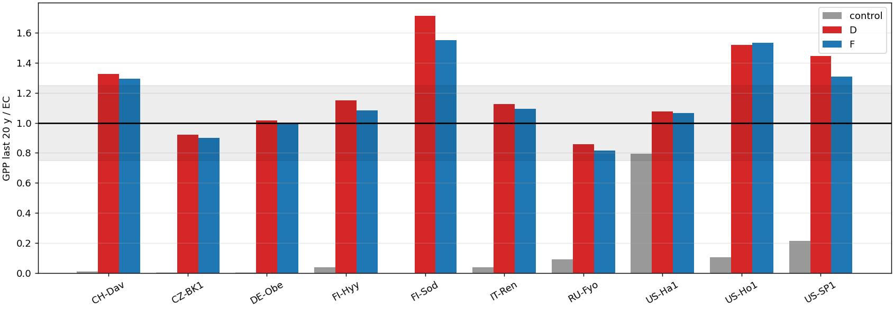

# Final needleleaf trials vs EC (D = cushion 2.4 + slatop 0.010, F = cushion 2.4 + slatop 0.008)

Control = original AD400 case (default parameters), same years. GPP_last20 = mean of the last 20 AD years.

```
control : alive 9/10, stable 4/10, within +/-25% of EC 1/10, median GPP/EC 0.04, median |log ratio| 3.25
D       : alive 10/10, stable 10/10, within +/-25% of EC 6/10, median GPP/EC 1.14, median |log ratio| 0.15
F       : alive 10/10, stable 10/10, within +/-25% of EC 6/10, median GPP/EC 1.09, median |log ratio| 0.15
RECOMMENDED: D (ranking: most sites alive, most within +/-25 % of EC, most stable, then smallest median |log GPP/EC|)
   with D: over-estimate (>1.25) ['FI-Sod', 'CH-Dav', 'US-Ho1', 'US-SP1']; under-estimate (<0.75) none; not yet stable none
```



| Site | Variant | GPP last 20 y | EC | ratio | trend %/decade | LAI | needleleaf alive | figure |
| --- | --- | ---: | ---: | ---: | ---: | ---: | --- | --- |
| DE-Obe | control | 0.02 | 4.90 | 0.00 | -25.67 | 0.01 | True | [png](DE-Obe/DE-Obe_final_trials.png) |
| DE-Obe | D | 4.97 | 4.90 | 1.01 | -0.36 | 4.32 | True | [png](DE-Obe/DE-Obe_final_trials.png) |
| DE-Obe | F | 4.89 | 4.90 | 1.00 | -0.56 | 3.73 | True | [png](DE-Obe/DE-Obe_final_trials.png) |
| FI-Sod | control | 0.00 | 1.73 | 0.00 | – | 0.00 | False | [png](FI-Sod/FI-Sod_final_trials.png) |
| FI-Sod | D | 2.96 | 1.73 | 1.71 | -2.78 | 3.09 | True | [png](FI-Sod/FI-Sod_final_trials.png) |
| FI-Sod | F | 2.68 | 1.73 | 1.55 | 3.62 | 2.43 | True | [png](FI-Sod/FI-Sod_final_trials.png) |
| FI-Hyy | control | 0.13 | 3.19 | 0.04 | -1.03 | 0.06 | True | [png](FI-Hyy/FI-Hyy_final_trials.png) |
| FI-Hyy | D | 3.68 | 3.19 | 1.15 | 0.75 | 3.31 | True | [png](FI-Hyy/FI-Hyy_final_trials.png) |
| FI-Hyy | F | 3.47 | 3.19 | 1.08 | -2.46 | 2.76 | True | [png](FI-Hyy/FI-Hyy_final_trials.png) |
| CH-Dav | control | 0.04 | 3.69 | 0.01 | -13.36 | 0.02 | True | [png](CH-Dav/CH-Dav_final_trials.png) |
| CH-Dav | D | 4.89 | 3.69 | 1.32 | -1.73 | 4.78 | True | [png](CH-Dav/CH-Dav_final_trials.png) |
| CH-Dav | F | 4.78 | 3.69 | 1.29 | -1.17 | 4.21 | True | [png](CH-Dav/CH-Dav_final_trials.png) |
| CZ-BK1 | control | 0.02 | 5.38 | 0.00 | -26.00 | 0.01 | True | [png](CZ-BK1/CZ-BK1_final_trials.png) |
| CZ-BK1 | D | 4.95 | 5.38 | 0.92 | -0.27 | 4.26 | True | [png](CZ-BK1/CZ-BK1_final_trials.png) |
| CZ-BK1 | F | 4.85 | 5.38 | 0.90 | -0.50 | 3.65 | True | [png](CZ-BK1/CZ-BK1_final_trials.png) |
| IT-Ren | control | 0.17 | 4.44 | 0.04 | -7.00 | 0.08 | True | [png](IT-Ren/IT-Ren_final_trials.png) |
| IT-Ren | D | 5.00 | 4.44 | 1.13 | -0.77 | 4.70 | True | [png](IT-Ren/IT-Ren_final_trials.png) |
| IT-Ren | F | 4.86 | 4.44 | 1.09 | -1.89 | 4.06 | True | [png](IT-Ren/IT-Ren_final_trials.png) |
| RU-Fyo | control | 0.37 | 4.05 | 0.09 | -0.99 | 0.19 | True | [png](RU-Fyo/RU-Fyo_final_trials.png) |
| RU-Fyo | D | 3.47 | 4.05 | 0.86 | -0.69 | 2.96 | True | [png](RU-Fyo/RU-Fyo_final_trials.png) |
| RU-Fyo | F | 3.30 | 4.05 | 0.81 | -3.52 | 2.52 | True | [png](RU-Fyo/RU-Fyo_final_trials.png) |
| US-Ho1 | control | 0.28 | 2.65 | 0.11 | -7.44 | 0.15 | True | [png](US-Ho1/US-Ho1_final_trials.png) |
| US-Ho1 | D | 4.03 | 2.65 | 1.52 | -1.72 | 3.58 | True | [png](US-Ho1/US-Ho1_final_trials.png) |
| US-Ho1 | F | 4.06 | 2.65 | 1.53 | -0.37 | 3.02 | True | [png](US-Ho1/US-Ho1_final_trials.png) |
| US-SP1 | control | 0.97 | 4.49 | 0.22 | 0.05 | 0.45 | True | [png](US-SP1/US-SP1_final_trials.png) |
| US-SP1 | D | 6.49 | 4.49 | 1.45 | -0.22 | 3.76 | True | [png](US-SP1/US-SP1_final_trials.png) |
| US-SP1 | F | 5.87 | 4.49 | 1.31 | -1.62 | 2.80 | True | [png](US-SP1/US-SP1_final_trials.png) |
| US-Ha1 | control | 3.34 | 4.20 | 0.80 | 3.20 | 1.82 | True | [png](US-Ha1/US-Ha1_final_trials.png) |
| US-Ha1 | D | 4.51 | 4.20 | 1.07 | 1.89 | 2.93 | True | [png](US-Ha1/US-Ha1_final_trials.png) |
| US-Ha1 | F | 4.48 | 4.20 | 1.07 | 1.74 | 2.73 | True | [png](US-Ha1/US-Ha1_final_trials.png) |
