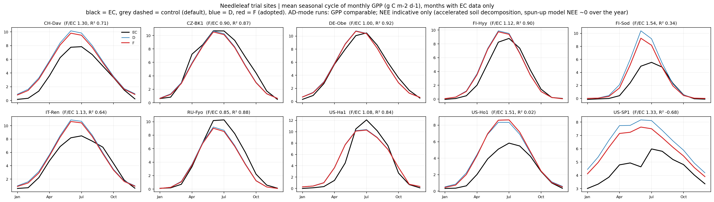
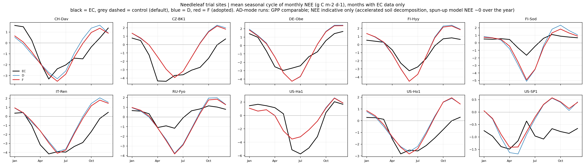

# Needleleaf trials: monthly GPP / NEE vs EC (last complete forcing cycle)

control = original AD400 case (default parameters); D = cushion 2.4 + slatop 0.010; **F = cushion 2.4 + slatop 0.008 (adopted)**. Same EC rules as the job's monthly overview (GPP NT before DT, NEE_VUT_REF, model NEE = -FATES_NEP, g C m-2 d-1).

**Caveat:** AD-mode runs: GPP comparable; NEE indicative only (accelerated soil decomposition, spun-up model NEE ~0 over the year).

```
GPP (monthly, last cycle vs EC; median over sites):
  D       (cushion 2.4 + slatop 0.010): sites 10, median R² 0.75, median RMSE 1.80, median bias +0.62, median model/EC 1.16
  F       (cushion 2.4 + slatop 0.008, adopted): sites 10, median R² 0.78, median RMSE 1.69, median bias +0.50, median model/EC 1.13
NEE (monthly, last cycle vs EC; median over sites):
  D       (cushion 2.4 + slatop 0.010): sites 10, median R² 0.04, median RMSE 1.65, median bias +0.36
  F       (cushion 2.4 + slatop 0.008, adopted): sites 10, median R² 0.12, median RMSE 1.55, median bias +0.34
```





| Site | Case | Flux | N months | R² | RMSE | bias | model mean | EC mean | model/EC | figure |
| --- | --- | --- | ---: | ---: | ---: | ---: | ---: | ---: | ---: | --- |
| DE-Obe | D | GPP | 216 | 0.92 | 1.06 | 0.08 | 4.95 | 4.87 | 1.02 | [png](DE-Obe/DE-Obe_trials_GPP_NEE_monthly_vs_EC.png) |
| DE-Obe | D | NEE | 216 | 0.53 | 1.25 | 0.25 | -0.36 | -0.61 | – | [png](DE-Obe/DE-Obe_trials_GPP_NEE_monthly_vs_EC.png) |
| DE-Obe | F | GPP | 216 | 0.92 | 1.05 | 0.02 | 4.89 | 4.87 | 1.00 | [png](DE-Obe/DE-Obe_trials_GPP_NEE_monthly_vs_EC.png) |
| DE-Obe | F | NEE | 216 | 0.57 | 1.19 | 0.22 | -0.39 | -0.61 | – | [png](DE-Obe/DE-Obe_trials_GPP_NEE_monthly_vs_EC.png) |
| FI-Sod | D | GPP | 201 | -0.09 | 2.29 | 1.33 | 3.07 | 1.74 | 1.77 | [png](FI-Sod/FI-Sod_trials_GPP_NEE_monthly_vs_EC.png) |
| FI-Sod | D | NEE | 201 | -3.26 | 1.71 | -0.61 | -0.34 | 0.27 | – | [png](FI-Sod/FI-Sod_trials_GPP_NEE_monthly_vs_EC.png) |
| FI-Sod | F | GPP | 201 | 0.34 | 1.78 | 0.94 | 2.68 | 1.74 | 1.54 | [png](FI-Sod/FI-Sod_trials_GPP_NEE_monthly_vs_EC.png) |
| FI-Sod | F | NEE | 201 | -2.48 | 1.55 | -0.68 | -0.41 | 0.27 | – | [png](FI-Sod/FI-Sod_trials_GPP_NEE_monthly_vs_EC.png) |
| FI-Hyy | D | GPP | 334 | 0.88 | 1.13 | 0.47 | 3.66 | 3.19 | 1.15 | [png](FI-Hyy/FI-Hyy_trials_GPP_NEE_monthly_vs_EC.png) |
| FI-Hyy | D | NEE | 334 | 0.43 | 1.11 | 0.30 | -0.33 | -0.62 | – | [png](FI-Hyy/FI-Hyy_trials_GPP_NEE_monthly_vs_EC.png) |
| FI-Hyy | F | GPP | 334 | 0.90 | 1.07 | 0.39 | 3.59 | 3.19 | 1.12 | [png](FI-Hyy/FI-Hyy_trials_GPP_NEE_monthly_vs_EC.png) |
| FI-Hyy | F | NEE | 334 | 0.48 | 1.06 | 0.27 | -0.35 | -0.62 | – | [png](FI-Hyy/FI-Hyy_trials_GPP_NEE_monthly_vs_EC.png) |
| CH-Dav | D | GPP | 312 | 0.66 | 1.75 | 1.32 | 5.00 | 3.68 | 1.36 | [png](CH-Dav/CH-Dav_trials_GPP_NEE_monthly_vs_EC.png) |
| CH-Dav | D | NEE | 348 | 0.24 | 1.72 | -0.02 | -0.65 | -0.63 | – | [png](CH-Dav/CH-Dav_trials_GPP_NEE_monthly_vs_EC.png) |
| CH-Dav | F | GPP | 312 | 0.71 | 1.60 | 1.12 | 4.79 | 3.68 | 1.30 | [png](CH-Dav/CH-Dav_trials_GPP_NEE_monthly_vs_EC.png) |
| CH-Dav | F | NEE | 348 | 0.37 | 1.56 | -0.16 | -0.79 | -0.63 | – | [png](CH-Dav/CH-Dav_trials_GPP_NEE_monthly_vs_EC.png) |
| CZ-BK1 | D | GPP | 264 | 0.88 | 1.42 | -0.41 | 4.95 | 5.36 | 0.92 | [png](CZ-BK1/CZ-BK1_trials_GPP_NEE_monthly_vs_EC.png) |
| CZ-BK1 | D | NEE | 264 | 0.02 | 2.29 | 1.49 | -0.41 | -1.90 | – | [png](CZ-BK1/CZ-BK1_trials_GPP_NEE_monthly_vs_EC.png) |
| CZ-BK1 | F | GPP | 264 | 0.87 | 1.46 | -0.51 | 4.85 | 5.36 | 0.90 | [png](CZ-BK1/CZ-BK1_trials_GPP_NEE_monthly_vs_EC.png) |
| CZ-BK1 | F | NEE | 264 | 0.06 | 2.24 | 1.47 | -0.43 | -1.90 | – | [png](CZ-BK1/CZ-BK1_trials_GPP_NEE_monthly_vs_EC.png) |
| IT-Ren | D | GPP | 305 | 0.61 | 2.15 | 0.77 | 5.24 | 4.47 | 1.17 | [png](IT-Ren/IT-Ren_trials_GPP_NEE_monthly_vs_EC.png) |
| IT-Ren | D | NEE | 305 | 0.07 | 2.03 | 1.26 | -0.70 | -1.96 | – | [png](IT-Ren/IT-Ren_trials_GPP_NEE_monthly_vs_EC.png) |
| IT-Ren | F | GPP | 305 | 0.64 | 2.05 | 0.60 | 5.07 | 4.47 | 1.13 | [png](IT-Ren/IT-Ren_trials_GPP_NEE_monthly_vs_EC.png) |
| IT-Ren | F | NEE | 305 | 0.19 | 1.90 | 1.15 | -0.81 | -1.96 | – | [png](IT-Ren/IT-Ren_trials_GPP_NEE_monthly_vs_EC.png) |
| RU-Fyo | D | GPP | 329 | 0.89 | 1.31 | -0.53 | 3.54 | 4.07 | 0.87 | [png](RU-Fyo/RU-Fyo_trials_GPP_NEE_monthly_vs_EC.png) |
| RU-Fyo | D | NEE | 329 | -1.08 | 1.52 | -0.56 | -0.33 | 0.23 | – | [png](RU-Fyo/RU-Fyo_trials_GPP_NEE_monthly_vs_EC.png) |
| RU-Fyo | F | GPP | 329 | 0.88 | 1.37 | -0.62 | 3.45 | 4.07 | 0.85 | [png](RU-Fyo/RU-Fyo_trials_GPP_NEE_monthly_vs_EC.png) |
| RU-Fyo | F | NEE | 329 | -1.18 | 1.56 | -0.62 | -0.39 | 0.23 | – | [png](RU-Fyo/RU-Fyo_trials_GPP_NEE_monthly_vs_EC.png) |
| US-Ho1 | D | GPP | 312 | 0.09 | 3.25 | 1.31 | 3.95 | 2.64 | 1.50 | [png](US-Ho1/US-Ho1_trials_GPP_NEE_monthly_vs_EC.png) |
| US-Ho1 | D | NEE | 336 | -0.20 | 1.51 | 0.78 | -0.30 | -1.07 | – | [png](US-Ho1/US-Ho1_trials_GPP_NEE_monthly_vs_EC.png) |
| US-Ho1 | F | GPP | 312 | 0.02 | 3.36 | 1.34 | 3.98 | 2.64 | 1.51 | [png](US-Ho1/US-Ho1_trials_GPP_NEE_monthly_vs_EC.png) |
| US-Ho1 | F | NEE | 336 | -0.20 | 1.51 | 0.76 | -0.31 | -1.07 | – | [png](US-Ho1/US-Ho1_trials_GPP_NEE_monthly_vs_EC.png) |
| US-SP1 | D | GPP | 232 | -1.25 | 2.64 | 1.93 | 6.41 | 4.47 | 1.43 | [png](US-SP1/US-SP1_trials_GPP_NEE_monthly_vs_EC.png) |
| US-SP1 | D | NEE | 232 | -1.12 | 1.59 | 0.60 | -0.32 | -0.93 | – | [png](US-SP1/US-SP1_trials_GPP_NEE_monthly_vs_EC.png) |
| US-SP1 | F | GPP | 232 | -0.68 | 2.28 | 1.47 | 5.94 | 4.47 | 1.33 | [png](US-SP1/US-SP1_trials_GPP_NEE_monthly_vs_EC.png) |
| US-SP1 | F | NEE | 232 | -0.94 | 1.53 | 0.68 | -0.25 | -0.93 | – | [png](US-SP1/US-SP1_trials_GPP_NEE_monthly_vs_EC.png) |
| US-Ha1 | D | GPP | 409 | 0.84 | 1.84 | 0.37 | 4.55 | 4.17 | 1.09 | [png](US-Ha1/US-Ha1_trials_GPP_NEE_monthly_vs_EC.png) |
| US-Ha1 | D | NEE | 409 | 0.56 | 2.08 | 0.42 | -0.31 | -0.73 | – | [png](US-Ha1/US-Ha1_trials_GPP_NEE_monthly_vs_EC.png) |
| US-Ha1 | F | GPP | 409 | 0.84 | 1.83 | 0.33 | 4.50 | 4.17 | 1.08 | [png](US-Ha1/US-Ha1_trials_GPP_NEE_monthly_vs_EC.png) |
| US-Ha1 | F | NEE | 409 | 0.57 | 2.06 | 0.40 | -0.32 | -0.73 | – | [png](US-Ha1/US-Ha1_trials_GPP_NEE_monthly_vs_EC.png) |
