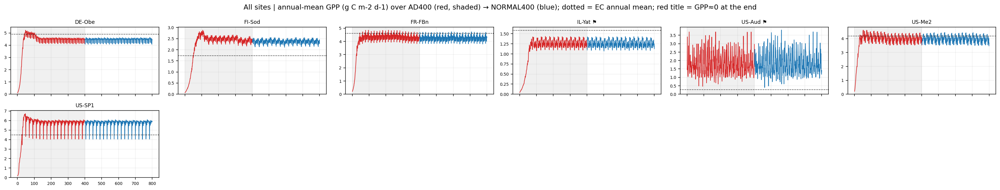
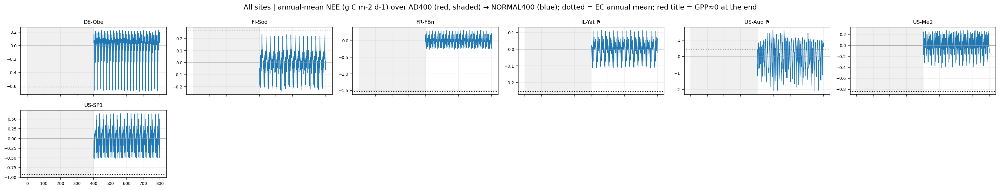

# New Normal400 figures: NewNormal400_figures_20261105T185105Z

Made with `plot_done_normal400.sh`, which uses Stage15 (carbon-pool convergence and monthly GPP / NEE against EC) and script 07 (800-year full sequence with the EC reference). Published 2026-11-05 19:08 UTC. Inputs: AD400 = `RUN_REFCASE` of each Normal400 case (needleleaf variant F `_NLF` / `_NLFP`, phenology patch `_PHEN`, Batch04 and HINONE cases).

800 model years do not prove equilibrium. The flags are hints for review, not conclusions. Only PNGs and metric tables are published; time-series tables with EC values stay on IRIDIS.

## Overviews

## Sites

| Site | AD400 → Normal400 | Carbon pools 800 y | Normal panels | Monthly GPP/NEE vs EC | Full sequence | Status | EC_GPP_mean | EC_NEE_mean | Flags |
|---|---|---|---|---|---|---|---|---|---|
| DE-Obe | `DE-Obe_B03_FIXNC_AD400_NLF` → `DE-Obe_B03_FIXNC_NORMAL400_NLF` | [png](convergence_EC/DE-Obe/DE-Obe_01_carbon_pools_AD400_NORMAL400.png) | [png](convergence_EC/DE-Obe/DE-Obe_02_carbon_pools_NORMAL400_panels.png) | [png](convergence_EC/DE-Obe/DE-Obe_GPP_NEE_monthly_overview.png) | [png](full_sequence/DE-Obe/DE-Obe_B03_FIXNC_NORMAL400_NLF/DE-Obe_03_GPP_NEE_full_sequence_AD400_NORMAL400.png) | OK | 4.90 | -0.61 |  |
| FI-Sod | `FI-Sod_B01_FIXNC_AD400_NLF` → `FI-Sod_B01_FIXNC_NORMAL400_NLF` | [png](convergence_EC/FI-Sod/FI-Sod_01_carbon_pools_AD400_NORMAL400.png) | [png](convergence_EC/FI-Sod/FI-Sod_02_carbon_pools_NORMAL400_panels.png) | [png](convergence_EC/FI-Sod/FI-Sod_GPP_NEE_monthly_overview.png) | [png](full_sequence/FI-Sod/FI-Sod_B01_FIXNC_NORMAL400_NLF/FI-Sod_03_GPP_NEE_full_sequence_AD400_NORMAL400.png) | OK | 1.73 | 0.27 |  |
| FR-FBn | `FR-FBn_B02_FIXNC_FOREST_GPPNPP_HISTFIX_AD400_NLF` → `FR-FBn_B02_FIXNC_FOREST_GPPNPP_HISTFIX_NORMAL400_NLF` | [png](convergence_EC/FR-FBn/FR-FBn_01_carbon_pools_AD400_NORMAL400.png) | [png](convergence_EC/FR-FBn/FR-FBn_02_carbon_pools_NORMAL400_panels.png) | [png](convergence_EC/FR-FBn/FR-FBn_GPP_NEE_monthly_overview.png) | [png](full_sequence/FR-FBn/FR-FBn_B02_FIXNC_FOREST_GPPNPP_HISTFIX_NORMAL400_NLF/FR-FBn_03_GPP_NEE_full_sequence_AD400_NORMAL400.png) | OK | 4.62 | -1.53 |  |
| IL-Yat | `IL-Yat_B03_FIXNC_BARE52_AD400_NLF` → `IL-Yat_B03_FIXNC_BARE52_NORMAL400_NLF` | [png](convergence_EC/IL-Yat/IL-Yat_01_carbon_pools_AD400_NORMAL400.png) | [png](convergence_EC/IL-Yat/IL-Yat_02_carbon_pools_NORMAL400_panels.png) | [png](convergence_EC/IL-Yat/IL-Yat_GPP_NEE_monthly_overview.png) | [png](full_sequence/IL-Yat/IL-Yat_B03_FIXNC_BARE52_NORMAL400_NLF/IL-Yat_03_GPP_NEE_full_sequence_AD400_NORMAL400.png) | OK | 1.59 | -0.25 | GPP<0.05 in 1 years |
| US-Aud | `US-Aud_AMF_B01SIX_FIXNC_AD400_DIRECT_HINONE` → `US-Aud_AMF_B01SIX_FIXNC_NORMAL400_DIRECT_HINONE` | [png](convergence_EC/US-Aud/US-Aud_01_carbon_pools_AD400_NORMAL400.png) | [png](convergence_EC/US-Aud/US-Aud_02_carbon_pools_NORMAL400_panels.png) | [png](convergence_EC/US-Aud/US-Aud_GPP_NEE_monthly_overview.png) | [png](full_sequence/US-Aud/US-Aud_AMF_B01SIX_FIXNC_NORMAL400_DIRECT_HINONE/US-Aud_03_GPP_NEE_full_sequence_AD400_NORMAL400.png) | OK | 0.27 | 0.45 | GPP step +40% at 400/401; GPP 6.50× EC; GPP trend -11%/100y (last 100y); LAI trend -12%/100y (last 100y) |
| US-Me2 | `US-Me2_AMF_B03_FIXNC_AD400_DIRECT_NLF` → `US-Me2_AMF_B03_FIXNC_NORMAL400_DIRECT_NLF` | [png](convergence_EC/US-Me2/US-Me2_01_carbon_pools_AD400_NORMAL400.png) | [png](convergence_EC/US-Me2/US-Me2_02_carbon_pools_NORMAL400_panels.png) | [png](convergence_EC/US-Me2/US-Me2_GPP_NEE_monthly_overview.png) | [png](full_sequence/US-Me2/US-Me2_AMF_B03_FIXNC_NORMAL400_DIRECT_NLF/US-Me2_03_GPP_NEE_full_sequence_AD400_NORMAL400.png) | OK | 4.20 | -0.84 |  |
| US-SP1 | `US-SP1_AMF_B04_FIXNC_AD400_BASETA_V1_NLF` → `US-SP1_AMF_B04_FIXNC_NORMAL400_BASETA_V1_NLF` | [png](convergence_EC/US-SP1/US-SP1_01_carbon_pools_AD400_NORMAL400.png) | [png](convergence_EC/US-SP1/US-SP1_02_carbon_pools_NORMAL400_panels.png) | [png](convergence_EC/US-SP1/US-SP1_GPP_NEE_monthly_overview.png) | [png](full_sequence/US-SP1/US-SP1_AMF_B04_FIXNC_NORMAL400_BASETA_V1_NLF/US-SP1_03_GPP_NEE_full_sequence_AD400_NORMAL400.png) | OK | 4.49 | -0.93 |  |

Tables: [convergence / flux summary](convergence_EC/AD400_NORMAL400_summary.csv), [full-sequence summary](full_sequence/full_sequence_summary.csv). Checksums: `SHA256SUMS`.
